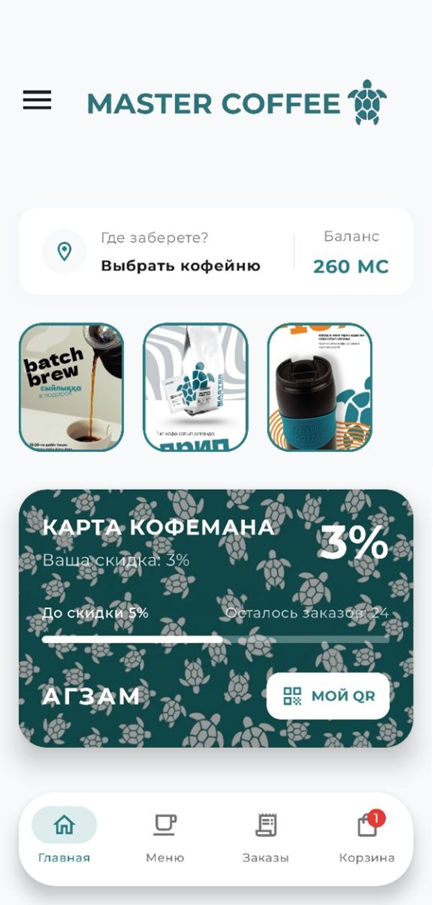

# Master Coffee — Cross-Platform Mobile MVP Ecosystem ☕📱

Концепт и MVP-версия мобильного приложения для сети кофеен **Master Coffee**, разработанная с целью автоматизации процесса заказов, минимизации очередей и геймификации системы лояльности.

Проект реализован на современном кроссплатформенном стеке разработки и демонстрирует подход к построению гибких мобильных систем с разделением бизнес-логики и UI.

---

## 🛠 Технологический стек (Tech Stack)

* **Frontend:**
  * **Kotlin** (100% кодовой базы).
  * **Compose Multiplatform** — декларативный UI-фреймворк для сборки нативных приложений под iOS и Android из единого исходного кода.
  * **Coil3** — оптимизированная асинхронная загрузка и кэширование медиа-контента.
* **Backend Architecture:**
  * **Backend-less подход** на базе облачной инфраструктуры **Firebase Firestore** (NoSQL база данных реального времени).
* **Networking:**
  * **Ktor Client** — легковесный и быстрый асинхронный HTTP-клиент для экосистемы Kotlin.

---

## 🚀 Ключевой функционал (Key Features)

1. **Интерактивный Главный экран (Interactive Home):**
  * Интеграция динамических **Stories** (формат Instagram) для мгновенного информирования гостей об акциях и новинках без необходимости обновления приложения в сторах.
  * Быстрый доступ к выбору ближайшей точки кофейни для самовывоза.
2. **Геймификация системы лояльности (Loyalty Program):**
  * Виртуальная карта лояльности с отображением баланса внутренней валюты **MC Coins**.
  * Визуальный прогресс-бар, мотивирующий пользователя повышать свой уровень скидки (динамический расчет от 3% до 10%).
3. **Умное меню и Конструктор напитков (Smart Menu):**
  * Интуитивная навигация по категориям (Классика, Авторские, Холодные напитки).
  * Экран кастомизации: самостоятельный выбор объема, температуры, альтернативного молока и сиропов. Исключает человеческий фактор и ошибки бариста при приеме заказа.
4. **QR-идентификация (QR Checkout):**
  * Генерация уникального QR-кода заказа для мгновенного сканирования на кассе, автоматического списания/начисления бонусов и проведения скидки в один скан.

---

## 🏗 Архитектурные особенности

* **Separation of Concerns:** Четкое разделение UI-слоя (Compose) и бизнес-логики.
* **Local Caching Strategy:** Использование стратегий кэширования данных для обеспечения мгновенного отклика интерфейса даже при нестабильном интернет-соединении.
* **Cloud Sync:** Мгновенная синхронизация изменений меню и акций напрямую из облака Firebase Firestore на экраны пользователей.

---

## 📱 Интерфейс приложения (Screenshots)


---

## 🔧 Как запустить проект локально (Local Setup)

1. Склонируйте репозиторий:
2. ```bash
   git clone [https://github.com/твой-логин/название-репозитория.git](https://github.com/твой-логин/название-репозитория.git)
   
2. Откройте проект в Android Studio (рекомендуется версия Ladybug или новее).
3. Добавьте ваш файл конфигурации google-services.json для Android и GoogleService-Info.plist для iOS в соответствующие модули для связи с вашим инстансом Firebase.
4. Синхронизируйте Gradle и запустите проект на эмуляторе или реальном устройстве.