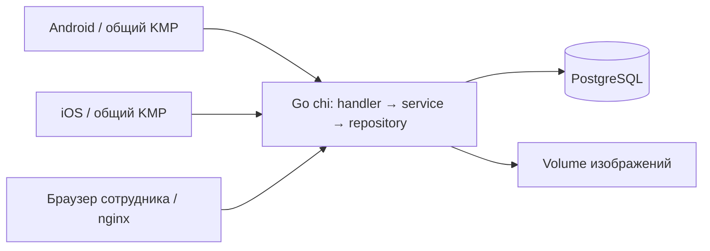
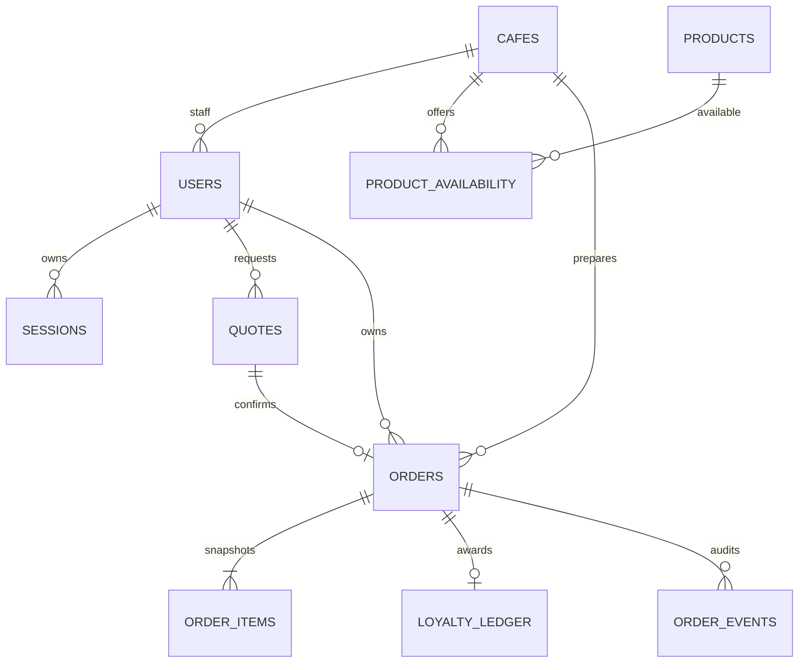

# Архитектура локального MVP

Gradle-проект остаётся в корне. `composeApp/` содержит общую KMP-логику и Android/iOS реализации HTTP и защищённого хранилища. `backend/` — единый Go API; `admin/` — статический кабинет сотрудника и администратора, nginx проксирует запросы API. PostgreSQL хранит все бизнес-данные. Внешние Firebase, Cloudinary, SMS и платёжные сервисы для запуска не требуются.

Авторизация: email/пароль, bcrypt, случайные сессии с истечением срока; в БД хранятся хеши сессионных токенов. Сервер назначает customer при регистрации, проверяет роль и кофейню для каждой операции сотрудника. Email остаётся неподтверждённым. Android шифрует токен ключом Keystore, iOS использует Keychain. Язык, тема и публичный каталог могут храниться в обычных настройках.

Версионированные SQL-файлы применяются транзакционно под advisory lock, контрольная сумма запрещает незаметное редактирование применённых миграций. Seed заполняет отсутствующие записи, не перезаписывая изменения оператора и пароли.

Деньги — целые KZT, `money_unit=whole_kzt`. Сервер проверяет кофейню, доступность, объём, добавки, количество и параметры. Пять минут действует расчёт quote. Клиент показывает сумму и только затем подтверждает quote с сохранённым idempotency key. При изменении цены сервер требует новый расчёт. Позиции сохраняют снимки названий, параметров и цен.

Создание заказа атомарно; advisory lock и уникальные ограничения защищают от повторных и конкурентных запросов. Клиент сохраняет ключ до отправки и очищает корзину только после ответа сервера. Неопределённый результат тайм-аута повторяется с тем же ключом.

Состояния заказа и оплаты независимы. Оплата происходит на кассе; сотрудник подтверждает фактически полученную оплату. QR содержит случайный серверный токен заказа, без личности и суммы; проверяются срок, кофейня и использование. Есть резервный поиск по номеру. Клиент наблюдает серверный статус через polling в активном lifecycle.

Лояльность — число оплаченных и выданных чеков с напитками. Уникальная запись журнала на заказ предотвращает повторное начисление. Пользователь не может задавать сумму, роль, баланс, оплату или состояние приготовления. MC Coins, промокоды и рефералы отключены.

## Обоснование и восстановление

Единый монолит Go/chi/PostgreSQL сохраняет исходный стек и позволяет транзакционно обработать заказ, оплату и лояльность. Статический кабинет не требует отдельного JavaScript runtime в production-контейнере. Крупный Gradle-переезд не требуется: AGP 8.13.2 сохраняется; миграция на AGP 9 — отдельная работа.

Это новая схема для локального MVP. Старый клиент Firebase не совместим с новым API; живые данные не импортируются. До миграции реальных данных нужны отдельные dry-run, проверка владельцев и согласованный план переноса. Для отката к исходникам используйте исходный commit в отдельном checkout; текущую БД сохраняйте отдельно. Резервные копии и проверка восстановления описаны в README; скрипт восстановления создаёт новую БД и отказывается перезаписывать существующую.
