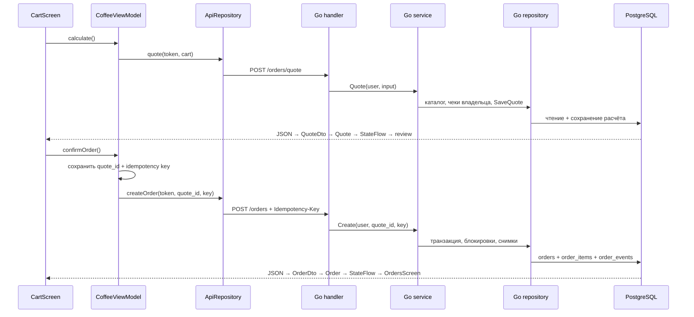

# Как изучать Master Coffee

Начните с одного заказа и проследите его от кнопки до PostgreSQL. Так проще понять, зачем существуют отдельные слои, чем читать все исходники подряд. Команды запуска и ограничения среды находятся в [README](../README.md), общая схема — в [архитектуре](architecture.md), результаты фактических запусков — в [отчёте о проверках](verification.md). Этот материал объясняет код, а не подтверждает работу на Xiaomi или iOS.

## Порядок чтения

1. [domain/Models.kt](../composeApp/src/commonMain/kotlin/kz/master_coffee/app/domain/Models.kt). Найдите `CartLine`, `Cart`, `Quote`, `Order`, `Session` и `CoffeeRepository`. Корзина хранит идентификаторы товара, объёма и добавок. В ней нет доверенной итоговой суммы. Расчёт и заказ приходят с сервера.
2. [presentation/ProductDialog.kt](../composeApp/src/commonMain/kotlin/kz/master_coffee/app/presentation/ProductDialog.kt) и [CheckoutScreens.kt](../composeApp/src/commonMain/kotlin/kz/master_coffee/app/presentation/CheckoutScreens.kt). Посмотрите, как настройки напитка превращаются в `CartLine`, а `CartScreen` вызывает `calculate()` и `confirmOrder()`. Здесь находятся подписи, отображение состояния и обработчики нажатий, но не серверные правила цены.
3. [presentation/CoffeeViewModel.kt](../composeApp/src/commonMain/kotlin/kz/master_coffee/app/presentation/CoffeeViewModel.kt). Начните с `CoffeeState`, затем прочитайте `calculate()`, `confirmOrder()`, `accountAction()` и `checkCurrent()`. После этого переходите к восстановлению сессии, выходу и polling. Это координатор пользовательских действий; `StateFlow` — наблюдаемое состояние экрана.
4. [data/ApiRepository.kt](../composeApp/src/commonMain/kotlin/kz/master_coffee/app/data/ApiRepository.kt) и [ApiDtos.kt](../composeApp/src/commonMain/kotlin/kz/master_coffee/app/data/ApiDtos.kt). Сравните доменную `CartLine` с `CartLineDto` и найдите заголовок `Idempotency-Key`. DTO описывают JSON-контракт; преобразования `domain()` и `dto()` отделяют его от моделей приложения.
5. [data/BackgroundStorage.kt](../composeApp/src/commonMain/kotlin/kz/master_coffee/app/data/BackgroundStorage.kt) и [LocalStore.kt](../composeApp/src/commonMain/kotlin/kz/master_coffee/app/data/LocalStore.kt). Затем прочитайте Android/iOS реализации, указанные ниже. Разберите, какие операции требуют завершённой записи перед отправкой HTTP-запроса.
6. [App.kt](../composeApp/src/commonMain/kotlin/kz/master_coffee/app/App.kt) и [presentation/CoffeeApp.kt](../composeApp/src/commonMain/kotlin/kz/master_coffee/app/presentation/CoffeeApp.kt). Здесь соединяются зависимости, тема, lifecycle, сбор `StateFlow` и выбор экрана. [Copy.kt](../composeApp/src/commonMain/kotlin/kz/master_coffee/app/presentation/Copy.kt), [ресурсы](../composeApp/src/commonMain/composeResources/) и [Images.kt](../composeApp/src/commonMain/kotlin/kz/master_coffee/app/presentation/Images.kt) отвечают за локализацию и сопоставление стабильных ключей изображений с ресурсами.
7. [backend/cmd/api/main.go](../backend/cmd/api/main.go), [handlers/http.go](../backend/internal/handlers/http.go), [service/service.go](../backend/internal/service/service.go) и [repository/repository.go](../backend/internal/repository/repository.go). Читайте по одному маршруту, например `POST /api/v1/orders`, а не по всему файлу за раз. Затем найдите соответствующие ограничения в [001_initial.sql](../backend/migrations/001_initial.sql).
8. [admin/app.mjs](../admin/app.mjs), [admin/lib.mjs](../admin/lib.mjs) и [OpenAPI](openapi.yaml). Кабинет — второй клиент того же API. Он позволяет увидеть, почему оплата, приготовление и пользовательская история меняются разными запросами.

## От нажатия до БД и обратно

Визуальная оболочка вынесена в [CoffeeShell.kt](../composeApp/src/commonMain/kotlin/kz/master_coffee/app/presentation/CoffeeShell.kt): исходная боковая шторка, плавающая навигация с тенью, нижние панели языка/темы. Она вызывает те же методы ViewModel и не хранит собственную копию бизнес-данных. Состояние шторки/панелей сбрасывается при смене аккаунта; Back сначала закрывает открытую панель.

Стрелки ответа в схеме сокращают обратный проход через все слои. Фактически UI получает результат через repository и ViewModel, а не читает БД напрямую.

### 1. Расчёт перед подтверждением

В `CartScreen` кнопка расчёта вызывает `CoffeeViewModel.calculate()`. Метод дожидается сохранения комментария, сохраняет текущую корзину и передаёт её в `ApiRepository.quote()`. `Cart.dto()` сериализует идентификаторы и выбранные параметры. Локальная оценка цены в корзине помогает пользователю ориентироваться, но не подтверждает заказ.

Go-маршрут в `Handler.Router()` вызывает `quote()`. Handler разбирает и проверяет JSON, берёт пользователя из серверной сессии и вызывает `Service.Quote()`. Service получает каталог выбранной кофейни и число чеков конкретного владельца. `Calculate()` проверяет доступность, принадлежность объёма товару, добавки, количество и параметры; рассчитывает целые KZT и округление. `Repository.SaveQuote()` сохраняет запрос и снимок расчёта в `quotes`.

Ответ проходит через `QuoteDto.domain()` в `Quote`. ViewModel обновляет `CoffeeState.quote`; Compose показывает карточку проверки суммы и срока действия. Если сервер требует новый расчёт, старое подтверждение нельзя считать действительным.

### 2. Создание заказа и неопределённый результат

`confirmOrder()` сначала проверяет сохранённую пару `quote_id` / `key` для текущего пользователя. Если пары нет, создаёт её и записывает **до** `createOrder()`. Метод `ApiRepository.createOrder()` передаёт `quote_id` в JSON, а ключ — в `Idempotency-Key`.

В backend `create()` передаёт запрос в `Service.Create()`. Service проверяет роль customer и в одной транзакции:

- сериализует операции с одинаковым ключом и проверяет `ExistingOrder()`;
- возвращает существующий заказ при повторе той же операции; другой расчёт с тем же ключом даёт конфликт;
- блокирует расчёт, каталог и запись пользователя, чтобы согласовать актуальную цену и уровень;
- заново рассчитывает заказ и требует нового просмотра при изменениях;
- через `InsertOrder()` создаёт `orders`, снимки `order_items` и событие `order_events`, затем фиксирует транзакцию.

В [схеме](../backend/migrations/001_initial.sql) найдите `UNIQUE(user_id,idempotency_key)` и уникальный `quote_id`: защита не ограничивается отключённой кнопкой. Сервер выдаёт номер, время и QR. QR содержит случайный токен, а не клиентскую сумму или персональные данные.

После подтверждённого ответа ViewModel сначала надёжно удаляет старую корзину и только потом очищает pending-пару. Если запись в хранилище не завершилась, ошибка видна, а данные восстановления не должны пропасть. При тайм-ауте или разрыве сети клиент сохраняет пару и повторяет прежний запрос. Новый ключ для такого повтора мог бы обозначить другую покупку.

### 3. Касса, приготовление, выдача

В кабинете `lookup()` ищет номер или QR через `/staff/orders/lookup`. Старые действия скрываются на время поиска, чтобы ошибка нового QR не оставила кнопку оплаты другого заказа. `mutateOrder()` отправляет оплату или следующий статус. [nextStatus()](../admin/lib.mjs) подсказывает доступную кнопку, но окончательную проверку выполняет `Service.Mutate()`.

Service проверяет роль и кофейню, блокирует запись заказа, повторно проверяет QR при его использовании и разделяет `payment_status` со статусом приготовления. После оплаты разрешён путь `created → accepted → preparing → ready → completed`. Для оплаченного заказа нет пользовательской кнопки «Я оплатил». На `completed` квалифицирующий чек записывается через `AwardReceipt()`; уникальность записи на заказ не позволяет начислить его дважды. Признаки `is_drink` и `loyalty_eligible` имеют разные назначения — скидка на напиток и участие чека в росте уровня.

Мобильный `restartPolling()` получает фактическое состояние активного заказа через repository. `App.kt` передаёт начало/остановку lifecycle в `setForeground()`, а UI собирает состояние через `collectAsStateWithLifecycle()`. Клиент видит готовность после ответа сервера. История показывает снимки заказа: изменение сегодняшнего меню не переписывает вчерашние позиции.

## Где живут состояние и данные

| Данные | Владелец и место | Что изучить |
| --- | --- | --- |
| Состояние экрана: загрузка, ошибка, корзина, выбранный заказ | `CoffeeState` в памяти ViewModel, наружу — `StateFlow` | `CoffeeViewModel`, `CoffeeApp`, `CheckoutScreens` |
| Настоящая сессия | Случайный токен у клиента; хеш и срок в PostgreSQL `sessions` | `Service.Authenticate`, `SessionUser`, `ApiRepository.me` |
| Защищённый токен Android | AES-GCM ciphertext в приватных preferences; ключ — Android Keystore | [PlatformServices.android.kt](../composeApp/src/androidMain/kotlin/kz/master_coffee/app/data/PlatformServices.android.kt) |
| Токен и durable-корзина/pending iOS | Keychain с `WhenUnlockedThisDeviceOnly`, отдельные account-ключи | [PlatformServices.ios.kt](../composeApp/src/iosMain/kotlin/kz/master_coffee/app/data/PlatformServices.ios.kt) |
| Публичный каталог, язык, тема | `SettingsLocalStore`; каталог разделён по кофейне и может быть показан без сети | `LocalStore.kt` |
| Корзина и pending Android | Приватное `durable_orders_v1`, отдельные ключи владельца; проверенный `commit()` | `AndroidDurableLocalStore` |
| Последний экран/кофейня/заказ | `SavedNavigation` и ключ с ID пользователя | `navigation()`, `persistNavigation()`, `establish()` |
| Заказы, расчёты, итог, право сотрудника, журнал лояльности | Только API/PostgreSQL | Go service, repository, SQL-ограничения |
| Сессия кабинета | Только память вкладки; после перезагрузки новый вход | `createApi()`, `endSession()` в `admin/` |

`BackgroundStorage.run()` выполняет синхронные платформенные операции на переданном фоновом dispatcher и сериализует их через `Mutex`. Поэтому выход не должен обгонять незавершённую запись прежнего аккаунта. Форматы существующих корзин и pending сохраняются; добавление фонового доступа не требует молча стирать пользовательские данные.

Обратите внимание на `migrate()` в платформенных durable-store: прежние `mvp.cart.<user>` / `mvp.pending.<user>` переносятся в канонические записи перед удалением старых. Маркер миграции не даёт запоздалому legacy-значению воскресить уже оформленную корзину после выхода или перезапуска. Повреждённая личная запись становится `STORAGE`-ошибкой и сохраняется для диагностики; публичный испорченный каталог можно перечитать с API.

Отмена корутины и проверка поколения решают разные задачи. `accountJob`/`authJob` отменяют ненужную работу, а `generation` + `checkCurrent()` запрещают применять запоздалый ответ к следующей сессии. Во время выхода UI аккаунта очищается; вход остаётся заблокирован на время удаления локальных данных. Публичный каталог можно сохранить, личные корзины и pending разных владельцев смешивать нельзя.

## Общий KMP-код и платформенные границы

| Общее `commonMain` | Android `androidMain` | iOS `iosMain` |
| --- | --- | --- |
| Доменные модели и repository-контракт | `MainActivity`, Android lifecycle/Back-интеграция | `MainViewController` |
| ViewModel, StateFlow, structured concurrency | Ktor OkHttp engine | Ktor Darwin engine |
| Compose-экраны, тема, RU/KK/EN | Android Keystore и private SharedPreferences | Keychain и Foundation/Security interop |
| DTO, Ktor-конфигурация, обработка ошибок | `BuildConfig` и debug/release API URL | URL из Info.plist/Xcode-настройки |
| Интерфейсы `LocalStore`, `SecureTokenStore`; `BackgroundStorage` | UUID, реализация `createPlatformServices()` | NSUUID, реализация `createPlatformServices()` |

Не передавайте Activity в общую ViewModel и не импортируйте Android Keystore в `commonMain`. Платформенные возможности приходят через `expect/actual` и интерфейсы. Ресурс изображения относится к UI: бизнес-модель хранит ключ/URL, а не `DrawableResource`. Наличие iOS target и исходников не подтверждает компиляцию Keychain/Darwin на Windows — для этого нужна отдельная macOS/Xcode-проверка.

Пример небольшой платформенной границы — [BackHandler.kt](../composeApp/src/commonMain/kotlin/kz/master_coffee/app/BackHandler.kt) и [BackHandler.android.kt](../composeApp/src/androidMain/kotlin/kz/master_coffee/app/BackHandler.android.kt). Общее приложение сообщает действие возврата, Android связывает его с системным Back.

## Как проверять небольшое изменение

- Общие клиентские тесты: [CoffeeViewModelTest.kt](../composeApp/src/commonTest/kotlin/kz/master_coffee/app/CoffeeViewModelTest.kt), [ApiRepositoryTest.kt](../composeApp/src/commonTest/kotlin/kz/master_coffee/app/ApiRepositoryTest.kt). Прочитайте проверки повторного ключа, отмены polling и позднего ответа после выхода перед изменением этих механизмов.
- Android UI: [MobileUiTest.kt](../composeApp/src/androidInstrumentedTest/kotlin/kz/master_coffee/app/testing/MobileUiTest.kt) работает с управляемыми repository/storage; [MobileBackendJourneyTest.kt](../composeApp/src/androidInstrumentedTest/kotlin/kz/master_coffee/app/testing/MobileBackendJourneyTest.kt) — отдельный opt-in сценарий с настоящим API. [Скрипт запуска](../scripts/run-instrumentation.sh) проверяет результат instrumentation, а не только exit code `adb`. Наличие этих файлов и сборка test APK не доказывают запуск на Xiaomi: смотрите фактический отчёт о проверках.
- Реальное соединение `MainActivity → App` проверяет отдельный [MainActivityLaunchTest.kt](../composeApp/src/androidInstrumentedTest/kotlin/kz/master_coffee/app/testing/MainActivityLaunchTest.kt). Он включается только на чистом проверочном устройстве параметром `masterCoffeeLaunchSmoke=true`; управляемый [MobileTestActivity](../composeApp/src/androidDebug/kotlin/kz/master_coffee/app/testing/MobileTestActivity.kt) решает другую задачу и не заменяет этот smoke-тест.
- Backend: тесты рядом с Go-пакетами, интеграции используют настоящий PostgreSQL и отдельные тестовые схемы. Одного запуска без `TEST_DATABASE_URL` недостаточно для доказательства PostgreSQL-проверок.
- Кабинет: `node --test admin/tests/*.test.mjs`; [браузерный сценарий](../admin/tests/browser-smoke.mjs) требует настоящего локального API и изолированного Chromium. Он создаёт тестовые заказы; не запускайте его против чужого окружения.
- Настоящий REST-цикл между ролями: [scripts/e2e.mjs](../scripts/e2e.mjs). Воспроизводимость сервисов проверяют [Compose](../compose.yaml), миграции и [CI](../.github/workflows/ci.yml). Android UI на физическом устройстве — отдельная проверка, которую нельзя заменить этим REST-тестом.

Для обычной Android-правки начните с `./gradlew :composeApp:testDebugUnitTest :composeApp:lintDebug :composeApp:assembleDebug` из корня. Команды подключения телефона и instrumentation запускайте по актуальному README: они требуют доступного и авторизованного устройства.

## Небольшие самостоятельные задачи

| Задача | Где менять | Как проверить результат |
| --- | --- | --- |
| Улучшить одну подсказку корзины на трёх языках | `Copy.kt` и `composeResources/values*` | RU/KK/EN, длинная строка, крупный шрифт; ключи ресурсов не потеряны |
| Добавить понятный перевод нового кода ошибки API в кабинете | `admin/lib.mjs` | Node-тест с этим кодом; серверный `code` сохраняется, сообщение объясняет следующий шаг |
| Добавить клиентский тест потери сети после отправки заказа | `CoffeeViewModelTest.kt` | Корзина/pending сохранены; повтор передаёт тот же ключ и получает прежний заказ |
| Проверить границу лояльности отдельным Go-подслучаем | `backend/internal/service/*test.go` | Сравнить соседние значения около 50/70/100; не менять коммерческие пороги без явного решения |
| Проверить стоп-лист кофейни через кабинет | `admin/app.mjs` и текущий API | На локальных данных выключить товар одной кофейни, убедиться в серверном отказе расчёта и вернуть доступность |
| Добавить тест ошибки фоновой записи | `BackgroundStorage` и клиентские тесты | Видимая `STORAGE`-ошибка; HTTP создания не отправлен, если ключ не сохранён |

После задачи просмотрите diff: изменение текста не должно затрагивать транзакции заказа, а тест не должен сохранять токены или пароли в отчёт. В PR указывайте, какое поведение изменилось, чем оно проверено и какие проверки среды не удалось выполнить.
